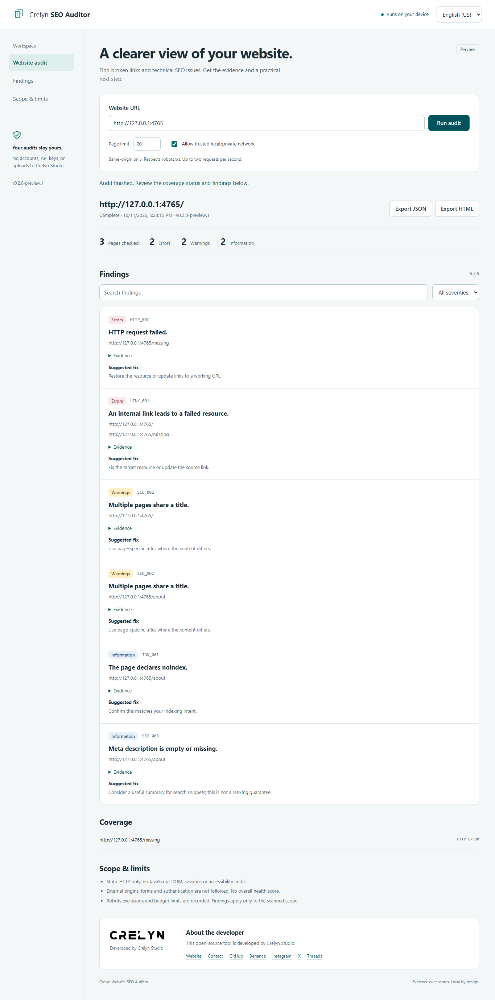

# Crelyn Website SEO Auditor

A local website audit tool for broken links, technical SEO, and passive HTTP health checks. Use the browser workspace or the command line, inspect evidence, and export private HTML or JSON reports.

**v0.2.0-preview.1 · Development preview · English (US) and Turkish UI · No accounts, API keys, telemetry, or cloud backend.**



[Mobile view](docs/screenshots/web-en-mobile.png) · [Turkish view](docs/screenshots/web-tr-desktop.png) · [Rules](docs/rules.md) · [Security model](docs/security-model.md)

## Start the web app

Install **Node.js 24** (minimum 22.18), download or clone this repository, and open a terminal in its root:

```sh
npm ci --ignore-scripts
npm run web
```

Open **http://127.0.0.1:4187** in your browser. Enter the final HTTP(S) origin of a site you control, choose a page budget, and run the audit. The browser app defaults to 20 pages and allows up to 100. Stop the server with Ctrl+C. To change the port:

```sh
npm run web -- --port 4180
```

The app binds only to your computer's loopback address. It is a local tool, not a hosted multi-user service. Use the displayed 127.0.0.1 address, rather than localhost. English (US) is the default; choose Türkçe in the header. Your language choice is remembered locally when browser storage is available.

If a browser keeps showing a different local project, use a fresh port with --port. A previously installed offline app can retain content for the same local origin. The default 4187 avoids the commonly reused 4173 preview address without clearing another project's browser data.

## What you can do

- Check failed HTTP resources, broken internal links, redirects, titles, descriptions, headings, canonicals, and noindex declarations.
- Review severity, stable rule IDs, affected URLs, evidence, and suggested fixes.
- Filter findings by severity or search; expand evidence with the keyboard.
- Run or cancel an audit from the browser; inspect complete, partial, or aborted coverage.
- Download JSON or a self-contained HTML report. Saved HTML supports language switching and filters without internet; it cannot start another scan.
- View the Crelyn Studio developer card and contact links.

Missing descriptions or headings are contextual advice, not proof of a ranking problem. Header checks are passive observations, not vulnerability tests. There is no overall SEO score or search ranking guarantee.

## Try the included example

Start the synthetic fixture in another terminal:

```sh
node examples/demo-server.mjs
```

In the web app enter **http://127.0.0.1:4765**, enable **Allow trusted local/private network**, and run an audit. Expect **3 checked pages, 2 errors, 2 warnings, and 2 information findings**. The broken link and duplicate titles are intentional. Fixture content is Turkish; it is source evidence, not untranslated interface text.

Enable private-network access only for trusted local targets. Public sites need no exception. A target URL may redirect from HTTP to HTTPS or between www and bare domains: supply its final origin, because cross-origin redirects are deliberately blocked.

## Command line

```sh
npm run build
node dist/src/cli/index.js --help
node dist/src/cli/index.js audit https://example.com --max-pages 20 --lang en_US
node dist/src/cli/index.js audit http://127.0.0.1:4765 --allow-private-network --lang tr --format html,json --output ./reports
```

After installing a locally packed package, the command is **site-audit**. The previous **sitemercek** command remains an alias. The package is **not published to npm**; install from this repository instead of assuming an npx package exists.

| Option | Default / values |
| --- | --- |
| --lang | en_US or tr; legacy en also accepted; JSON uses en/tr for schema compatibility |
| --max-pages | CLI default 100; range 1–1000 page candidates, including failures and non-HTML |
| --max-depth | 4; range 0–10; start/sitemap URLs begin at depth 0 |
| --concurrency | 2; range 1–2; request starts at least 500 ms apart |
| --timeout | 10000 ms; range 100–60000 per attempt, includes DNS/body, excludes rate waiting |
| --format | terminal; comma-separated terminal,html,json |
| --output | ./reports for file outputs |
| --fail-on | none, error, warning; warning includes errors |
| --allow-private-network | Off; explicit exception for trusted local/private targets |

Terminal output uses stdout; progress uses stderr. JSON alone without --output goes to stdout. File outputs have unique filenames and never overwrite existing files.

Exit codes: **0** complete below threshold; **1** invalid input, runtime failure, or partial/aborted coverage; **2** complete above the chosen finding threshold. An HTTP error finding can still have complete coverage; an unreachable resource makes coverage incomplete.

## Privacy, network policy, and limits

The scanner sends requests to the target origin from your computer. It does not send audits to Crelyn Studio. Reports can include sensitive URLs, query strings, response headers, and page text: review them before sharing. Set-Cookie and WWW-Authenticate are excluded.

- HTTP(S) GET only; no login, cookie jar, form submission, or external-origin crawling.
- All DNS answers are validated; sockets are pinned to an approved address. Private/reserved addresses are blocked by default. TLS verification stays enabled; environment proxies are ignored.
- robots.txt is checked before content. The crawler identifies as **CrelynSEOAuditor**. Matching agent groups merge; wildcard groups are used otherwise. Network/5xx/429 robots failures deny access; other 4xx permit it.
- Five redirect hops, 2 MiB wire/expanded bodies, 16 sitemap documents, XML depth 32, 10,000 discovered URLs and links per document, and bounded request attempts.
- At most two simultaneous requests with 500 ms between starts; one bounded retry for 429/503.
- Exclusions and budget limits conservatively produce partial coverage. Read status and skippedChecks before findings.
- Static HTML only: no JavaScript-rendered target DOM, Core Web Vitals, full accessibility/security audit, legacy charset conversion, sessions, or history comparison.

Installation requires npm access; public scans require access to the target. After installation, local fixtures work without internet. Saved HTML embeds its CSS, JavaScript, and logo, makes no automatic external requests, and uses a hashed script Content Security Policy. Developer links contact their platforms only when clicked.

The web API requires the exact loopback Host, matching Origin, and a per-session token; accepts bounded JSON input; permits one scan at a time. Do not expose it through a public reverse proxy. See the [security model](docs/security-model.md).

## Development and checks

```sh
npm run typecheck
npm run lint
npm test
npm run build
npm pack --dry-run
npm audit
```

Tests use local HTTP servers and injected DNS, not third-party targets. GitHub Actions checks Node 22 and 24 on Windows, Linux, and macOS. See [verification status](docs/implementation-status.md), [architecture](docs/architecture.md), [CONTRIBUTING](CONTRIBUTING.md), and [SECURITY](SECURITY.md).

[Sample HTML](docs/examples/demo-tr.html) · [Sample JSON](docs/examples/demo-tr.json) · [Terminal output](docs/examples/terminal-tr.txt). These are actual outputs from the included synthetic fixture.

## Developer and license


Developed by **Crelyn Studio**. [Website](https://crelynstudio.com) · [Email](mailto:info@crelynstudio.com) · [GitHub](https://github.com/crelynstudio) · [Behance](https://www.behance.net/crelynstudio) · [Instagram](https://www.instagram.com/crelynstudio/) · [X](https://x.com/crelynstudio) · [Threads](https://www.threads.com/@crelynstudio).

Source code is [MIT licensed](LICENSE). Crelyn Studio names, marks, and logos are not licensed for unrestricted trademark use by the software license. Third-party dependency licenses remain their own. No platform affiliation or endorsement is implied.
