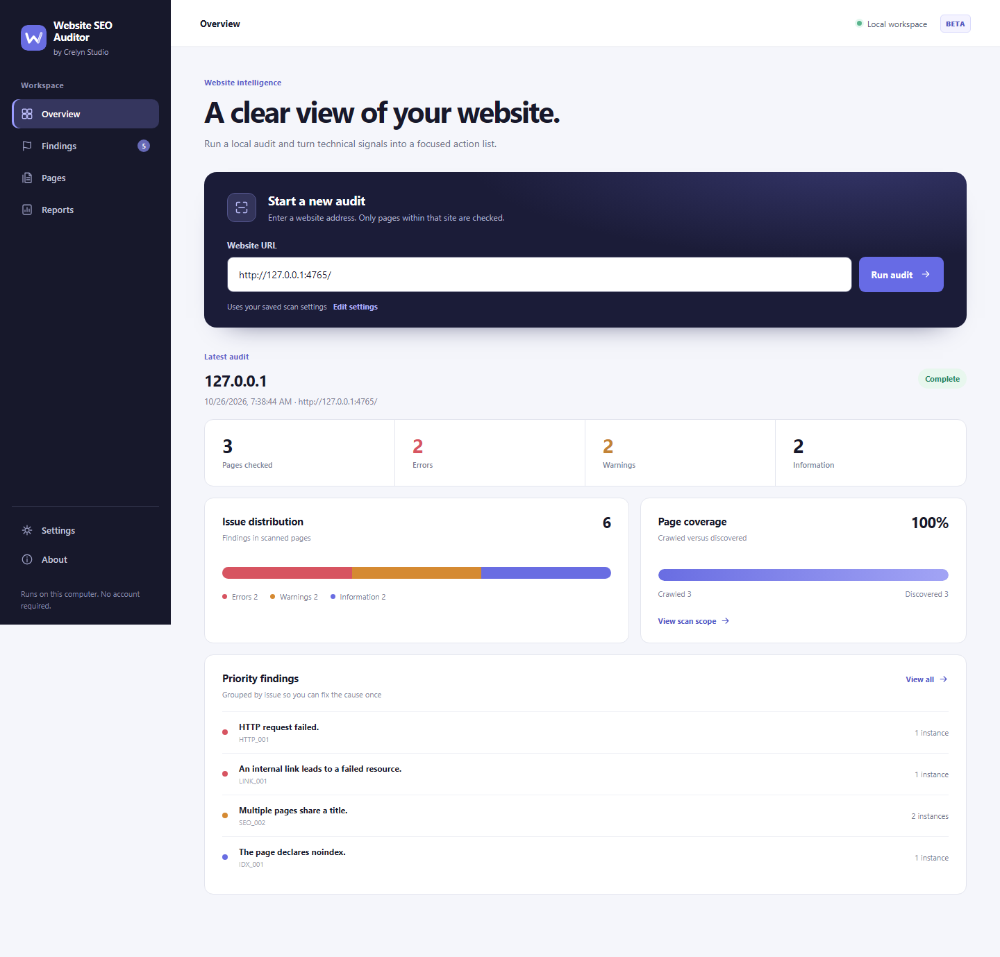
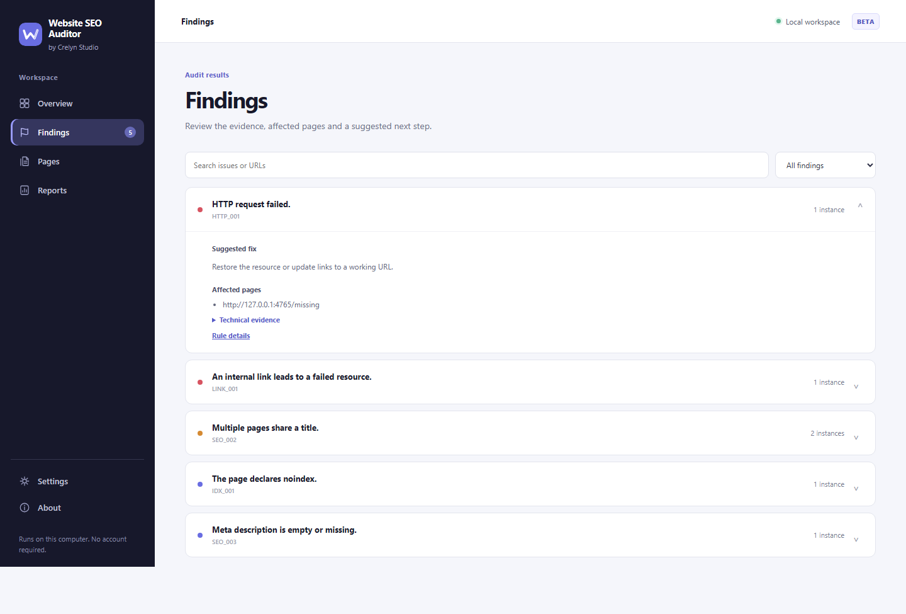
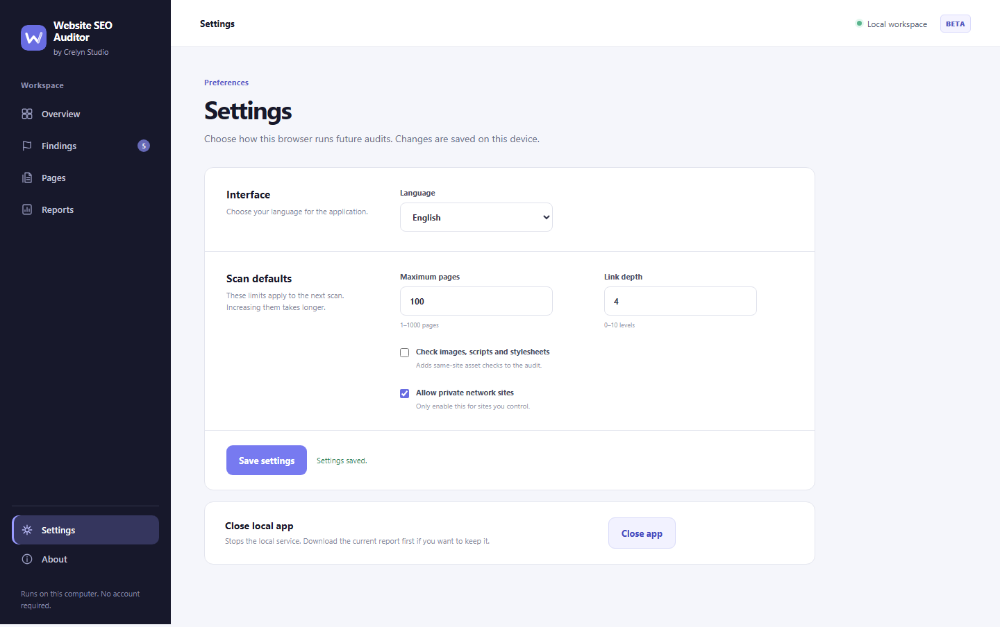

# Website SEO Auditor


**A local web app for clear, private technical SEO audits.** Developed by Crelyn Studio. [Türkçe rehber](README.tr.md).

Enter a website address, review the scan, and work through grouped findings with affected pages, technical evidence and suggested fixes. The app opens in your browser while its crawler runs on your computer. No account, API key, cloud backend or Electron runtime is needed.

**Status:** `0.5.0-beta.1` is a local review candidate and has not been published. The [earlier Windows beta](https://github.com/crelynstudio/crelyn-studio-website-seo-auditor/releases/tag/v0.4.0-beta.1) is still the public release.







The screenshots come from the running app and a synthetic local sample website. Its findings are test data.

## What it checks

- Public, same-origin pages found in links and sitemaps, while respecting `robots.txt`.
- HTTP failures, broken internal links, redirects, titles, descriptions, headings, canonical URLs and indexing directives.
- Optional same-origin images, scripts and stylesheets.
- Page coverage and issue distribution based on the actual scan, plus downloadable HTML and JSON reports.

The **Settings** page saves language (English or Turkish), page and depth limits, resource checks and private-network permission in this browser. A scan can be stopped. Partial scans are labeled. [Rule details](docs/rules.md).

## Run from source

On Windows, install Node.js 24 and npm, then run:

```powershell
npm ci
npm run app
```

The app opens in your default browser at a random `127.0.0.1` address. Keep the command running while you use the app; press Ctrl+C to stop it. The review candidate does not yet include a one-click Windows download. Developers can also use the [command-line interface](docs/cli.md).

To verify the project:

```powershell
npm run typecheck
npm run lint
npm test
npm run test:package
```

Installing dependencies needs access to the npm registry. Once installed, the app needs no external service to open or view an exported report. Scanning a public website requires a network connection to that website.

## Privacy and limits

The local server binds to `127.0.0.1` and rejects foreign request origins and hostnames. Reports stay in local server memory until it stops; download HTML or JSON to keep one. Settings remain in this browser's local storage. No telemetry or upload to Crelyn Studio is used. Common secrets are masked in exports, but arbitrary page text and URL paths can still contain private information. **Review reports before sharing.** [Security model](docs/security-model.md) · [Report a vulnerability](SECURITY.md).

The crawler reads static HTML. It cannot sign in or inspect JavaScript-rendered content. It does not measure Google rankings or guarantee SEO outcomes. The default scan covers up to 100 pages at link depth 4. Only a local browser workflow has been checked for this candidate; there is no hosted version or automatic update mechanism.

## Developer and license

**Developed by Crelyn Studio** · [Website](https://crelynstudio.com) · [Contact](mailto:info@crelynstudio.com) · [GitHub](https://github.com/crelynstudio)

Source code is [MIT licensed](LICENSE). Crelyn Studio names and logos are separate brand assets; MIT does not grant trademark rights. The original Website SEO Auditor app mark is included for this project. Purchased UI8 source icons are not included.

The Windows portable preview bundles Node.js 24.19.0 under its [own license](third_party/Node.js-LICENSE.txt), also included in the portable folder. Production dependencies keep their own license files.
