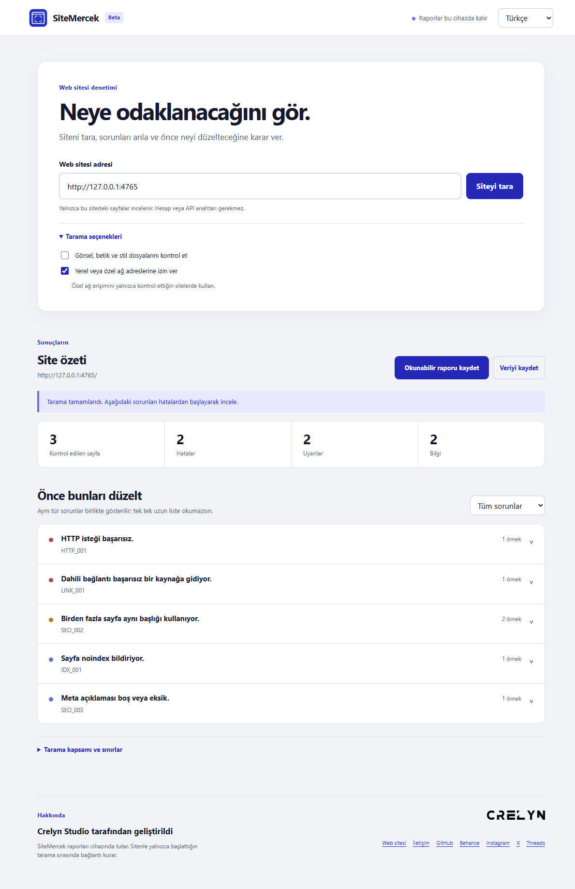

# SiteMercek

**Private website audits for Windows.** Developed by Crelyn Studio. [Türkçe rehber](README.tr.md).

Enter a website address, run a scan, and see what needs attention. SiteMercek groups similar technical SEO and broken link issues, then shows affected pages, evidence and suggested fixes. The Windows app needs no account, API key, cloud service or terminal.

**Status: [0.4.0-beta.1 Windows prerelease](https://github.com/crelynstudio/crelyn-studio-website-seo-auditor/releases/tag/v0.4.0-beta.1). The installer is not code signed.**



## Try it

1. Enter a full URL such as `https://example.com` and select **Scan website**.
2. Review the scan status. Partial and stopped scans are identified clearly.
3. Open an issue to see affected pages, evidence and a suggested fix.
4. Save a readable HTML report or JSON data using the buttons above the results.

The screenshot uses a synthetic local test site; its numbers are examples. The interface supports English and Turkish and remembers the selected language on the device.

## Checks and limits

- Public, same origin pages discovered from links and sitemaps, respecting `robots.txt`.
- HTTP failures, broken internal links, redirects, titles, descriptions, headings, canonical URLs and indexing directives.
- Optional same origin images, scripts and stylesheets.

The default scan limit is 100 pages and depth 4. Requests have size, time and rate limits. SiteMercek reads static HTML; it cannot sign in or inspect JavaScript rendered content. It offers no Google ranking score or guarantee. [Rule details](docs/rules.md).

## Privacy

Scanning needs network access to the target site. Reports remain on your device and work offline; there is no telemetry or upload to Crelyn Studio. Private network addresses are blocked unless explicitly enabled for a site you control. Common secrets are masked in saved reports, but arbitrary page text or URL paths may still contain sensitive information. **Review reports before sharing.** [Security model](docs/security-model.md) · [Report a vulnerability](SECURITY.md).

## Build from source

Requires Windows x64, Node.js 24 and npm. Dependency installation needs npm registry access.

```powershell
npm ci
npm run typecheck
npm run lint
npm test
npm run dist:win
```

Open `.build/win-unpacked/SiteMercek.exe` to try the packaged app. The unsigned installer is `.build/SiteMercek-0.4.0-beta.1-win-x64-setup.exe`. Windows may show a publisher or SmartScreen warning for unsigned builds. Build output is ignored by Git. The existing command line engine remains available for developers: [CLI reference](docs/cli.md).

## Known beta limits

- Only the Windows x64 package has been checked.
- The installer is unsigned; a trusted Crelyn Studio signing identity is not available yet.
- Authentication, JavaScript rendered pages, external origins and accessibility audits are out of scope.
- There are no automatic updates; new versions require a new download.

## Developer and license

**Developed by Crelyn Studio** · [Website](https://crelynstudio.com) · [Contact](mailto:info@crelynstudio.com) · [GitHub](https://github.com/crelynstudio)

Source code is [MIT licensed](LICENSE). Crelyn Studio names and logos are separate brand assets; MIT does not grant trademark rights. The generated SiteMercek app mark is included for this project. The purchased UI8 icon pack is not included in this repository.
