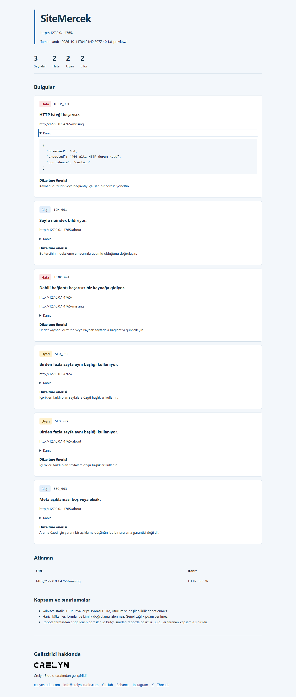

# SiteMercek

Find what broke, understand why, and know exactly what to fix.

**v0.1.0-preview.1 — local development preview, not published to npm.** A small CLI for website health and technical SEO. English by default, Turkish with `--lang tr`. Findings include evidence, severity, stable rule IDs and a suggested fix. No score, account, API key or telemetry.

[Türkçe](README.tr.md) · [Rules](docs/rules.md) · [Security model](docs/security-model.md) · [Implementation status](docs/implementation-status.md)

## Install and try in 60 seconds

Node.js 24 recommended; minimum 22.18. Open a terminal **inside this repository**, then:

```sh
npm ci
npm run build
node dist/src/cli/index.js --help
node dist/src/cli/index.js --version
```

For a reproducible demonstration, start the included local fixture in one terminal:

```sh
node examples/demo-server.mjs
```

In a second terminal in the repository:

```sh
npm run dev -- http://127.0.0.1:4765 --max-pages 20 --lang tr --allow-private-network
node dist/src/cli/index.js audit http://127.0.0.1:4765 --allow-private-network --format html,json --output ./reports
node dist/src/cli/index.js audit http://127.0.0.1:4765 --allow-private-network --fail-on error --format json
```

The demonstration intentionally includes a broken link and duplicate titles. The last command exits **2**. These are fixture data, not a real customer website. Stop the server with Ctrl+C. For your own public site, replace the URL and omit `--allow-private-network`. HTTPS-to-HTTP or `www` redirects cross the origin boundary: provide the final origin explicitly.

The proposed future command is `npx @crelynstudio/sitemercek <url>` **after publication**. Package/organization availability has not been verified. No external publication has taken place.

## Options and outputs

| Option | Default / allowed values |
| --- | --- |
| `--lang` | `en`, `tr` |
| `--max-pages` | 100; 1–1000 fetched page candidates, including errors and non-HTML |
| `--max-depth` | 4; 0–10; start/sitemap URLs are depth 0 |
| `--concurrency` | 2; 1–2; at least 500 ms between request starts |
| `--timeout` | 10000 ms; 100–60000, includes DNS and body reading per attempt |
| `--format` | `terminal`; comma-separated `terminal,html,json` |
| `--output` | `./reports` for file outputs |
| `--fail-on` | `none`; `error`, `warning`, `none` |
| `--allow-private-network` | off; explicit exception for trusted local/private targets |

`sitemercek <url>` and `sitemercek audit <url>` have the same meaning. Use `node dist/src/cli/index.js` in place of `sitemercek` before installing the package. `--about` shows developer/contact information.

Terminal goes to stdout. **JSON alone without `--output` goes to stdout**, with progress on stderr. Other combinations save requested JSON/HTML files to `--output` or `./reports`. Filenames use timestamp and random suffix, exclusive creation; existing files are never overwritten. HTML is a standalone UTF-8 file with an embedded local logo, no scripts, CDN or third-party requests; open it by double-clicking. Evidence can be expanded with the keyboard. Machine error/reason codes remain stable English identifiers in both languages.

Exit **0**: complete scan below the selected threshold. Exit **1**: invalid input, runtime/network failure or partial/aborted scan. Exit **2**: complete scan exceeds the threshold (`warning` includes errors). `none` does not convert incomplete scans to success. Normal HTTP 404/500 findings can produce exit 2; an unreachable resource makes scan coverage incomplete and produces exit 1.

## Read a report

Start with `status` and `skippedChecks`, then severity, URL, `observed`, `expected` and recommendation. An absent finding does not mean every possible check passed. `noindex` is informational, missing descriptions/H1 are not critical, and header advice is passive observation rather than a security test. Duplicate titles apply only to scanned, distinct final HTML URLs. Canonicals are validated syntactically, not fetched.

Real local example reports and terminal output are in [docs/examples](docs/examples). All example data are synthetic fixture content processed by the real CLI.



[Mobile screenshot](docs/screenshots/report-tr-mobile.png) · [HTML example](docs/examples/demo-tr.html) · [JSON example](docs/examples/demo-tr.json) · [Actual terminal output](docs/examples/terminal-tr.txt)

## Safety, privacy and limits

- Only GET, HTTP(S), original origin. No login, cookie jar, form submission or external-origin crawling.
- DNS answers are all validated and the connection is pinned to an approved address. TLS validation stays enabled. Environment proxies are deliberately ignored.
- robots.txt is checked before content. 4xx except 429 permits access; 5xx, 429/network failures deny it. Robots redirects stay within the original origin, a deliberate stricter policy than RFC cross-authority redirect guidance.
- Up to five redirects, 2 MiB compressed and decompressed bodies, 16 sitemap documents, XML depth 32, 10,000 discovered URLs and links per document. Discovery or resource budget limits are recorded as partial.
- Rate limit: maximum two simultaneous requests, starts spaced 500 ms apart; one retry for 429/503 only if Retry-After is 0–5 seconds (otherwise stop that resource).
- No JavaScript rendering, Core Web Vitals, full accessibility audit, vulnerability scan, sessions, diff or plugins. UTF-8 HTML supported; legacy charset transcoding is not implemented.
- robots exclusions and page/depth limits conservatively make the scan partial. Use a narrow public target or increase supported budgets when appropriate.
- Reports include target URLs, query strings, observed page text and response headers. Keep reports private when these contain sensitive data. Set-Cookie and WWW-Authenticate are not retained. Site data are sent only to the target origin, never to Crelyn Studio.

Installation needs npm network access. Scanning requires access to the target server; this is not an offline website scanner. After dependencies are installed, local fixtures and generated HTML/JSON can be used without internet. See [security assumptions](docs/security-model.md).

## Development and checks

```sh
npm run typecheck
npm run lint
npm test
npm run build
npm pack --dry-run
npm audit
```

Tests use local HTTP servers and injected DNS; they do not crawl third-party websites. Tests include the built CLI, report files and exit codes. Cross-platform Node 22/24 CI is configured; remote CI results are not yet verified. See [CONTRIBUTING](CONTRIBUTING.md), [SECURITY](SECURITY.md), [architecture](docs/architecture.md) and [roadmap](docs/roadmap.md).

## Developer and license


Developed by **Crelyn Studio**. [Website](https://crelynstudio.com) · [Email](mailto:info@crelynstudio.com) · [GitHub](https://github.com/crelynstudio) · [Behance](https://www.behance.net/crelynstudio) · [Instagram](https://www.instagram.com/crelynstudio/) · [X](https://x.com/crelynstudio) · [Threads](https://www.threads.com/@crelynstudio).

Source code is [MIT licensed](LICENSE). Crelyn Studio names, marks and logos are not licensed for unrestricted trademark use by the software license. Third-party dependency licenses remain their own. No platform affiliation or endorsement is implied.
