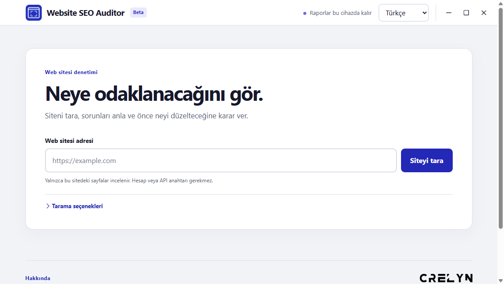
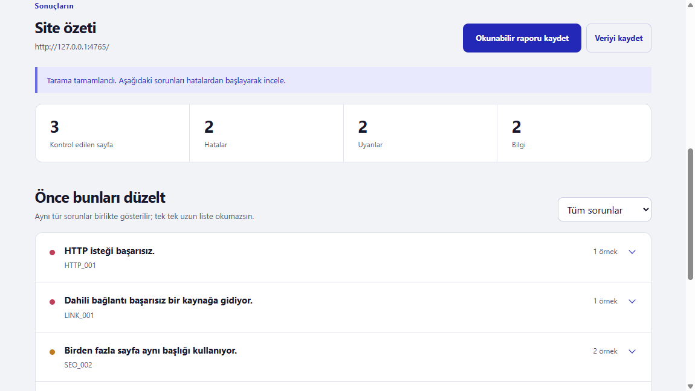

# Website SEO Auditor

**Windows için sade ve yerel web sitesi denetimi.** Crelyn Studio tarafından geliştirildi. [English README](README.md)

Site adresini gir, taramayı başlat ve hangi sorunlara odaklanacağını gör. Website SEO Auditor benzer teknik SEO ve bozuk bağlantı sorunlarını gruplar; etkilenen sayfaları, kanıtı ve düzeltme önerisini gösterir. Windows uygulamasını kullanmak için hesap, API anahtarı, bulut hizmeti veya terminal gerekmez.

**Durum: [0.4.0-beta.1 Windows ön sürümü](https://github.com/crelynstudio/crelyn-studio-website-seo-auditor/releases/tag/v0.4.0-beta.1). Kurulum dosyası imzasızdır.**





## Deneme

1. `https://example.com` gibi tam bir adres girip **Siteyi tara** düğmesine bas.
2. Tarama durumuna bak. Kısmi ve durdurulmuş taramalar açıkça belirtilir.
3. Bir sorunu açarak etkilenen sayfaları, kanıtı ve öneriyi incele.
4. Sonuçların üstündeki düğmelerle okunabilir HTML raporu veya JSON verisi kaydet.

Sonuç görüntüsünde yapay bir yerel test sitesi kullanıldı; rakamlar örnektir. Arayüz İngilizce ve Türkçe çalışır, dil seçimi cihazda hatırlanır.

## Kontroller ve sınırlar

- Bağlantılardan ve site haritasından keşfedilen aynı kökenli sayfalar; `robots.txt` kurallarına uyulur.
- HTTP hataları, bozuk dahili bağlantılar, yönlendirmeler, başlıklar, açıklamalar, heading yapısı, canonical adresler ve indeksleme bildirimi.
- İsteğe bağlı aynı kökenli görsel, betik ve stil dosyaları.

Varsayılan sınır 100 sayfa ve 4 derinlik seviyesidir. İsteklere boyut, süre ve hız sınırları uygulanır. Website SEO Auditor statik HTML okur; siteye giriş yapamaz veya JavaScript sonrası oluşan içeriği inceleyemez. Google sıralama puanı veya garanti sunmaz. [Kural ayrıntıları](docs/rules.md).

## Gizlilik

Tarama hedef siteye ağ erişimi ister. Raporlar cihazında kalır ve internetsiz açılır; Crelyn Studio'ya yükleme veya telemetri yoktur. Özel ağ adresleri, kontrol ettiğin bir site için açıkça izin vermedikçe engellenir. Yaygın sırlar raporda maskelenir; serbest sayfa metni veya URL yolları hassas bilgi içerebilir. **Raporu paylaşmadan önce kontrol et.** [Güvenlik modeli](docs/security-model.md) · [Güvenlik açığı bildirimi](SECURITY.md).

## Kaynak koddan derleme

Windows x64, Node.js 24 ve npm gerekir. Bağımlılık kurulumu npm erişimi ister.

```powershell
npm ci
npm run typecheck
npm run lint
npm test
npm run dist:win
```

Paketlenmiş uygulamayı `.build/win-unpacked/Website SEO Auditor.exe` ile dene. İmzasız kurulum dosyası `.build/Website-SEO-Auditor-0.4.0-beta.1-win-x64-setup.exe` yolundadır. Windows imzasız dosya için yayıncı veya SmartScreen uyarısı gösterebilir. Derleme çıktısı Git'e eklenmez. Mevcut komut satırı motoru geliştiriciler için korunur: [CLI rehberi](docs/cli.md).

## Bilinen beta sınırları

- Şimdiye kadar yalnızca Windows x64 paketi kontrol edildi.
- Kurulum dosyası imzasızdır; Crelyn Studio adına güvenilir kod imzalama kimliği henüz yoktur.
- Giriş gerektiren sayfalar, JavaScript sonrası içerik, dış kökenler ve erişilebilirlik denetimi kapsam dışıdır.
- Otomatik güncelleme yoktur; sonraki sürüm yeniden indirilir.

## Geliştirici ve lisans

**Crelyn Studio tarafından geliştirildi** · [Web sitesi](https://crelynstudio.com) · [İletişim](mailto:info@crelynstudio.com) · [GitHub](https://github.com/crelynstudio)

Kaynak kod [MIT lisanslıdır](LICENSE). Crelyn Studio adı ve logoları ayrı marka varlıklarıdır; yazılım lisansı marka kullanım hakkı vermez. Üretilen Website SEO Auditor uygulama işareti bu projeye dahildir. Satın alınan UI8 simge paketi bu depoya eklenmemiştir.
